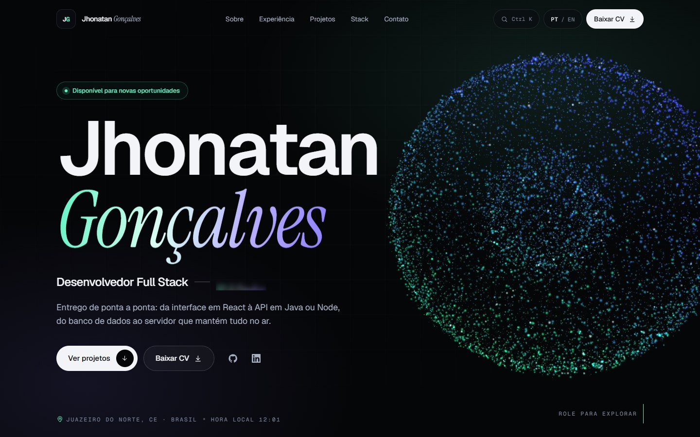
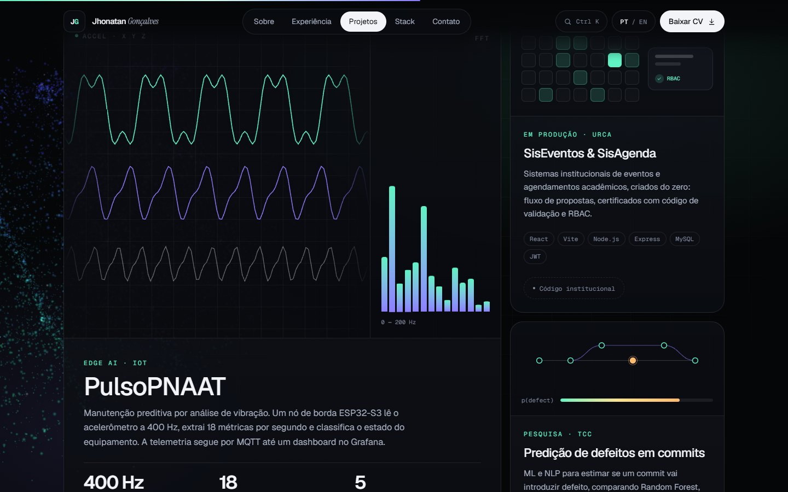
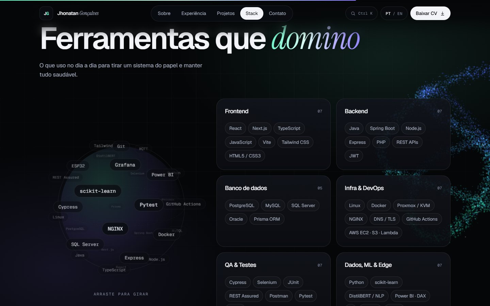
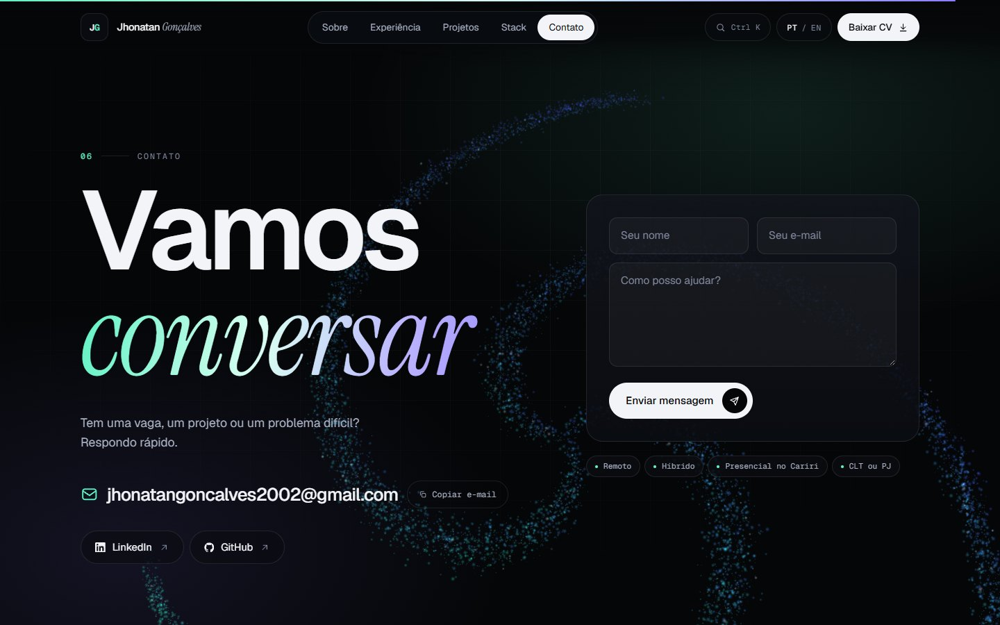

# Jhonatan Gonçalves — Portfólio

Site pessoal de [Jhonatan Gonçalves Pereira](https://www.linkedin.com/in/jhonatan-goncalves-pereira), Desenvolvedor Full Stack e Analista de Sistemas.

**[jhonatan-goncalves-pereira.github.io/curriculo](https://jhonatan-goncalves-pereira.github.io/curriculo/)**

[](https://github.com/jhonatan-goncalves-pereira/curriculo/actions/workflows/deploy.yml)

[](https://jhonatan-goncalves-pereira.github.io/curriculo/)

| Projetos | Stack | Contato |
| :-: | :-: | :-: |
|  |  |  |

## O que tem aqui

- **Cena 3D em WebGL puro.** Um sistema de 15 mil partículas que se transforma em seis formas (núcleo, hélice, relevo, malha, nó, galáxia) conforme a seção em tela, reage ao cursor e é desenhado em uma única chamada. O shader é próprio e não há biblioteca 3D: o renderizador inteiro tem cerca de 300 linhas ([`src/components/webgl`](src/components/webgl)).
- **Intro que não espera JavaScript.** A cortina de abertura e a entrada do hero são keyframes CSS presentes no HTML do servidor, então começam no primeiro paint.
- **Português e inglês.** Conteúdo tipado em [`src/content`](src/content); o idioma é detectado pelo navegador e a escolha fica salva.
- **Paleta de comandos** (`Ctrl K` / `⌘ K`) para navegar, copiar o e-mail e baixar o currículo.
- **Detalhes de interação:** cards com inclinação 3D e borda que acompanha o cursor, esfera de tecnologias arrastável, botões magnéticos, scroll suave.
- **Acessível por padrão:** HTML semântico, navegação por teclado, foco visível, contraste AA e respeito a `prefers-reduced-motion` (sem WebGL e sem animações longas).
- **SEO:** metadados Open Graph, dados estruturados `schema.org/ProfilePage` e sitemap.

## Stack

| Camada | Escolha |
| :-- | :-- |
| Framework | Next.js 16 (App Router) com export estático |
| Linguagem | TypeScript em modo estrito |
| UI | React 19 · Tailwind CSS 4 |
| 3D | WebGL com GLSL, sem dependências |
| Animação | Motion · keyframes CSS · Lenis (scroll suave) |
| Deploy | GitHub Actions → GitHub Pages |

## Qualidade medida

Lighthouse 12 sobre o build de produção, em 12/10/2026:

| | Performance | Acessibilidade | Boas práticas | SEO |
| :-- | :-: | :-: | :-: | :-: |
| Desktop | 99 | 100 | 100 | 100 |
| Mobile (CPU 4× mais lenta) | 83 | 100 | 100 | 100 |

Duas decisões explicam a maior parte do resultado: trocar a biblioteca 3D por WebGL direto (239 kB a menos de JavaScript comprimido) e iniciar a cena só depois do `load`, em tempo ocioso.

## Rodando localmente

Requer Node.js 20.9 ou superior.

```bash
npm install
npm run dev        # http://localhost:3000/curriculo
```

| Script | O que faz |
| :-- | :-- |
| `npm run dev` | Servidor de desenvolvimento |
| `npm run build` | Gera o site estático em `out/` (inclui checagem de tipos) |
| `npm run lint` | ESLint |
| `npm run typecheck` | `tsc --noEmit` |
| `npm run check` | Lint e build, como o CI |

## Estrutura

```text
src/
├── app/                  layout, página, metadados, estilos globais
├── content/              textos em pt.ts e en.ts, com um tipo compartilhado
├── components/
│   ├── sections/         Hero, Sobre, Experiência, Projetos, Stack, Formação, Contato
│   ├── ui/               peças reutilizáveis (reveals, tilt, paleta, esfera de tecnologias)
│   ├── webgl/            renderizador, shaders, formas e matrizes da cena de partículas
│   └── providers/        scroll suave, idioma e sinais de scroll e cursor
└── lib/                  stores, hooks e constantes do site
```

Para atualizar o conteúdo, edite `src/content/pt.ts` e `src/content/en.ts`. Os dois seguem o tipo `Dictionary`, então o compilador avisa se um idioma ficar para trás.

## Deploy

Cada push na `main` executa [`deploy.yml`](.github/workflows/deploy.yml): lint, build e publicação no GitHub Pages. O site é servido em `/curriculo`; esse caminho está em `next.config.ts` (`basePath`) e em `src/lib/site.ts`.

## Licença

O código pode ser consultado e reaproveitado como referência. Textos, currículo e fotografia são pessoais e não devem ser reutilizados.
